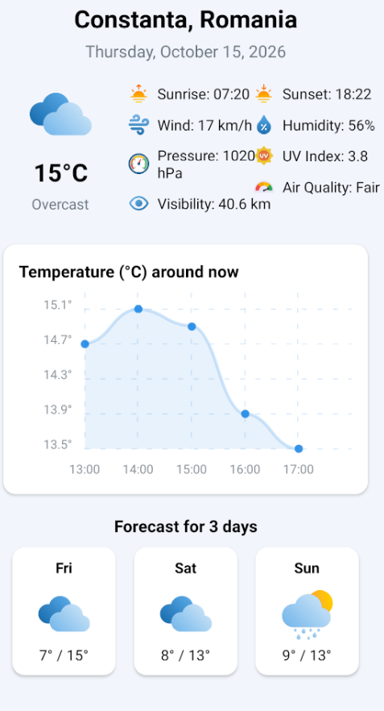

# WeatherDashboard-React-Native-App



Download apk file: https://drive.google.com/file/d/1_O1-9bLOOOcAt_0W2C4Z7tO59pgB9j7X/view?usp=sharing

Weather Dashboard app for Android (VremeaAzi), developed with React Native, Expo and TypeScript,
tested on Genymotion (Android emulator). It shows the weather in Constanta, Romania, from the free
[Open-Meteo](https://open-meteo.com) APIs (no API key needed).

## Features

* Current weather: temperature, description and icon (all WMO weather codes), wind, pressure,
  humidity, visibility, UV index, sunrise / sunset
* Air quality from the Open-Meteo Air Quality API (European AQI: Good, Fair, Moderate, Poor,
  Very poor, Extremely poor)
* Temperature chart for the current hour ± 2 hours
* 3-day forecast with min / max temperature and the icon of each day
* Pull to refresh; error message with *Try again* when there is no connection
* Times and date shown in the local time of the city (`timezone=auto`), whatever the phone's time zone

## How it works

The two APIs are called in parallel (`Promise.all`). The forecast API returns parallel arrays
(`hourly.time[]`, `hourly.temperature_2m[]`...) and numeric weather codes; the app reads the current
values from the `current` block, picks the hours around the current hour for the chart, and maps
the weather codes to icons and descriptions.

## Tech stack

Expo SDK 54, React Native 0.81, React 19, TypeScript, axios, react-native-chart-kit,
react-native-svg.

Visual Studio Code extensions: Babel JS, React Native Tools

## How to use

```bash
git clone https://github.com/GeoTuxMan/WeatherDashboard-React-Native-App.git
cd WeatherDashboard-React-Native-App
npm install
npx expo start
```

Open Genymotion, start a virtual device, then type `a` in the Expo terminal (or open the app in Expo Go).

## Build the APK

```bash
npm install -g eas-cli
eas login
eas build -p android --profile preview
```

Install it on Genymotion by dragging the `.apk` onto the emulator window, or with
`adb install -r VremeaAzi.apk`.
